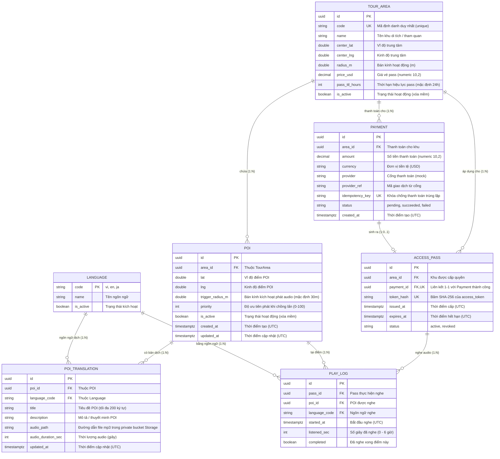

# ERD — Mô hình Dữ liệu và Quan hệ Thực thể

Tài liệu thiết kế cấu trúc Cơ sở dữ liệu cho dự án MultiGuide Backend, đối chiếu chuẩn xác theo **Mục 6 của PRD v1.2**.

---

## 1. Sơ đồ Quan hệ Thực thể (Mermaid Diagram)

---

## 2. Chi tiết Đặc tả Các Bảng CSDL (Schema: public)

### 2.1. `language`
* **Mô tả:** Danh mục ngôn ngữ được hỗ trợ trong hệ thống (vi, en, ja, ...).
* **Khóa chính:** `code` (varchar, ví dụ: "vi", "en").

| Tên cột | Kiểu dữ liệu | Nullable | Mặc định | Ràng buộc / Ghi chú |
|---|---|:---:|---|---|
| `code` | `varchar(10)` | NO | - | **PK**. Mã ISO ngôn ngữ ("vi", "en", "ja"). |
| `name` | `varchar(100)` | NO | - | Tên hiển thị ("Tiếng Việt", "English"). |
| `is_active` | `boolean` | NO | `true` | Cờ bật/tắt ngôn ngữ. |

---

### 2.2. `tour_area`
* **Mô tả:** Khu di tích, danh lam thắng cảnh hoặc khu vực tham quan.
* **Khóa chính:** `id` (uuid).

| Tên cột | Kiểu dữ liệu | Nullable | Mặc định | Ràng buộc / Ghi chú |
|---|---|:---:|---|---|
| `id` | `uuid` | NO | `gen_random_uuid()` | **PK**. |
| `code` | `varchar(50)` | NO | - | **UNIQUE**. Mã URL-friendly (chữ thường, số, gạch ngang). |
| `name` | `varchar(200)` | NO | - | Tên khu tham quan. |
| `center_lat` | `double precision` | NO | - | Tọa độ tâm (vĩ độ). |
| `center_lng` | `double precision` | NO | - | Tọa độ tâm (kinh độ). |
| `radius_m` | `double precision` | NO | - | Bán kính bao quanh khu (mét). |
| `price_usd` | `numeric(10,2)` | NO | - | Giá vé mua pass (USD). |
| `pass_ttl_hours` | `integer` | NO | `24` | Thời gian hiệu lực của vé tính từ lúc mua (giờ). |
| `is_active` | `boolean` | NO | `true` | Xóa mềm (`false` là đã tắt). |

---

### 2.3. `poi` (Point of Interest)
* **Mô tả:** Các điểm dừng chân, hiện vật hoặc trạm thuyết minh trong khu vực.
* **Khóa chính:** `id` (uuid).

| Tên cột | Kiểu dữ liệu | Nullable | Mặc định | Ràng buộc / Ghi chú |
|---|---|:---:|---|---|
| `id` | `uuid` | NO | `gen_random_uuid()` | **PK**. |
| `area_id` | `uuid` | NO | - | **FK** -> `tour_area(id)` (`ON DELETE RESTRICT`). |
| `lat` | `double precision` | NO | - | Vĩ độ thực tế điểm POI. |
| `lng` | `double precision` | NO | - | Kinh độ thực tế điểm POI. |
| `trigger_radius_m` | `double precision` | NO | `30` | Bán kính kích hoạt phát âm thanh (5m - 200m). |
| `priority` | `integer` | NO | `0` | Độ ưu tiên (0 - 100) khi du khách đứng giữa nhiều POI. |
| `is_active` | `boolean` | NO | `true` | Xóa mềm. |
| `created_at` | `timestamptz` | NO | `NOW()` | Thời gian tạo (UTC). |
| `updated_at` | `timestamptz` | NO | `NOW()` | Thời gian cập nhật (UTC). |

* **Chỉ mục (Indexes):**
  - `idx_poi_area_active`: `(area_id, is_active)` (tối ưu lọc POI theo khu).
  - `idx_poi_location`: `(lat, lng)` (tối ưu lọc bounding box vị trí).

---

### 2.4. `poi_translation`
* **Mô tả:** Nội dung thuyết minh và file ghi âm đa ngôn ngữ cho từng POI.
* **Khóa chính:** `id` (uuid).

| Tên cột | Kiểu dữ liệu | Nullable | Mặc định | Ràng buộc / Ghi chú |
|---|---|:---:|---|---|
| `id` | `uuid` | NO | `gen_random_uuid()` | **PK**. |
| `poi_id` | `uuid` | NO | - | **FK** -> `poi(id)` (`ON DELETE RESTRICT`). |
| `language_code` | `varchar(10)` | NO | - | **FK** -> `language(code)` (`ON DELETE RESTRICT`). |
| `title` | `varchar(200)` | NO | - | Tên điểm dừng theo ngôn ngữ (tối đa 200 ký tự). |
| `description` | `text` | NO | - | Bài thuyết minh chi tiết. |
| `audio_path` | `varchar(500)` | YES | `NULL` | Đường dẫn file mp3 trong bucket Storage (private). |
| `audio_duration_sec` | `integer` | YES | `NULL` | Độ dài file audio (giây). |
| `updated_at` | `timestamptz` | NO | `NOW()` | Thời gian cập nhật (UTC). |

* **Ràng buộc duy nhất:** `UNIQUE (poi_id, language_code)` (Mỗi POI chỉ có 1 bản dịch cho 1 ngôn ngữ).

---

### 2.5. `payment`
* **Mô tả:** Lịch sử giao dịch thanh toán mua vé tham quan.
* **Khóa chính:** `id` (uuid).

| Tên cột | Kiểu dữ liệu | Nullable | Mặc định | Ràng buộc / Ghi chú |
|---|---|:---:|---|---|
| `id` | `uuid` | NO | `gen_random_uuid()` | **PK**. |
| `area_id` | `uuid` | NO | - | **FK** -> `tour_area(id)` (`ON DELETE RESTRICT`). |
| `amount` | `numeric(10,2)` | NO | - | Số tiền thanh toán. |
| `currency` | `varchar(10)` | NO | `'USD'` | Loại tiền tệ. |
| `provider` | `varchar(50)` | NO | `'mock'` | Cổng thanh toán. |
| `provider_ref` | `varchar(100)` | YES | `NULL` | Mã tham chiếu giao dịch cổng ngoài. |
| `idempotency_key` | `varchar(100)` | NO | - | **UNIQUE**. Khóa chống gọi trùng lặp (Idempotency). |
| `status` | `varchar(20)` | NO | `'pending'` | Trạng thái: `pending`, `succeeded`, `failed`. |
| `created_at` | `timestamptz` | NO | `NOW()` | Thời gian khởi tạo (UTC). |

---

### 2.6. `access_pass`
* **Mô tả:** Thẻ quyền truy cập nội dung thuyết minh số được cấp sau thanh toán.
* **Khóa chính:** `id` (uuid).

| Tên cột | Kiểu dữ liệu | Nullable | Mặc định | Ràng buộc / Ghi chú |
|---|---|:---:|---|---|
| `id` | `uuid` | NO | `gen_random_uuid()` | **PK**. |
| `area_id` | `uuid` | NO | - | **FK** -> `tour_area(id)` (`ON DELETE RESTRICT`). |
| `payment_id` | `uuid` | NO | - | **FK, UNIQUE** -> `payment(id)` (1 Payment cấp tối đa 1 Pass). |
| `token_hash` | `varchar(64)` | NO | - | **UNIQUE**. Mã băm SHA-256 (64 ký tự hex) của token. |
| `issued_at` | `timestamptz` | NO | `NOW()` | Thời điểm cấp vé (UTC). |
| `expires_at` | `timestamptz` | NO | - | Thời điểm hết hạn vé (UTC). |
| `status` | `varchar(20)` | NO | `'active'` | Trạng thái vé: `active`, `revoked`. |

---

### 2.7. `play_log`
* **Mô tả:** Ghi nhận lịch sử nghe audio của du khách phục vụ thống kê phân tích.
* **Khóa chính:** `id` (uuid).

| Tên cột | Kiểu dữ liệu | Nullable | Mặc định | Ràng buộc / Ghi chú |
|---|---|:---:|---|---|
| `id` | `uuid` | NO | `gen_random_uuid()` | **PK**. |
| `pass_id` | `uuid` | NO | - | **FK** -> `access_pass(id)` (`ON DELETE RESTRICT`). |
| `poi_id` | `uuid` | NO | - | **FK** -> `poi(id)` (`ON DELETE RESTRICT`). |
| `language_code` | `varchar(10)` | NO | - | **FK** -> `language(code)` (`ON DELETE RESTRICT`). |
| `started_at` | `timestamptz` | NO | `NOW()` | Thời điểm bấm nghe (UTC). |
| `listened_sec` | `integer` | NO | `0` | Thời lượng thực tế đã nghe (giây, [0 - 6 giờ]). |
| `completed` | `boolean` | NO | `false` | Đã nghe trọn vẹn điểm thuyết minh. |

* **Chỉ mục (Indexes):**
  - `idx_playlog_poi_started`: `(poi_id, started_at)` (tối ưu thống kê lượt nghe theo điểm).

---

## 3. Các Quy Tắc Bảo Mật và Tích Hợp CSDL
1. **Row Level Security (RLS):** Bật RLS cho tất cả 7 bảng và không tạo policy công khai; Backend kết nối trực tiếp qua Postgres connection string (server pooler) có toàn quyền.
2. **Quyền riêng tư (Privacy):** Tuyệt đối **không lưu tọa độ GPS của khách** vào bất kỳ bảng nào trong cơ sở dữ liệu.
3. **Múi giờ:** Tất cả các trường thời gian đều lưu UTC (`timestamptz`).
