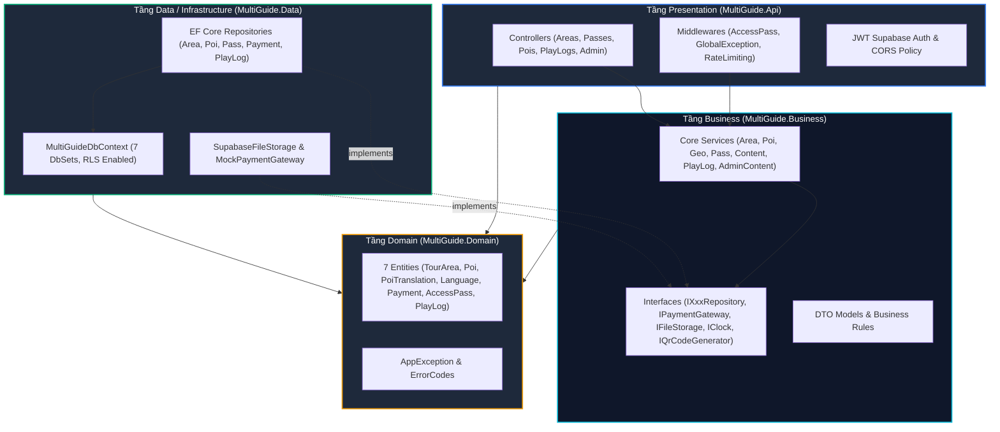
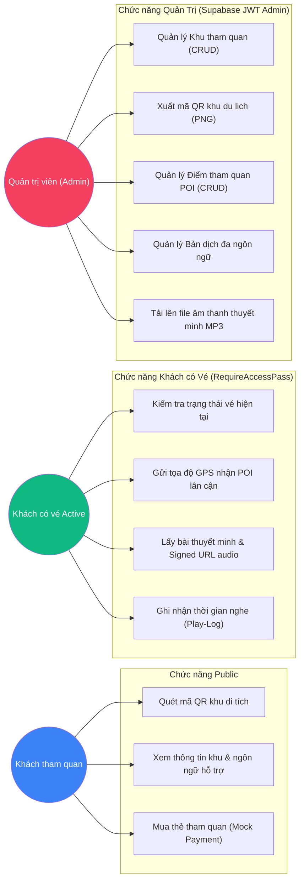
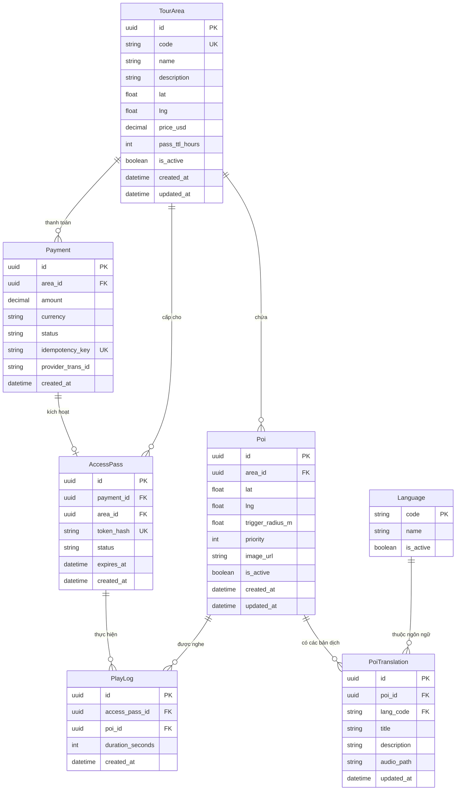
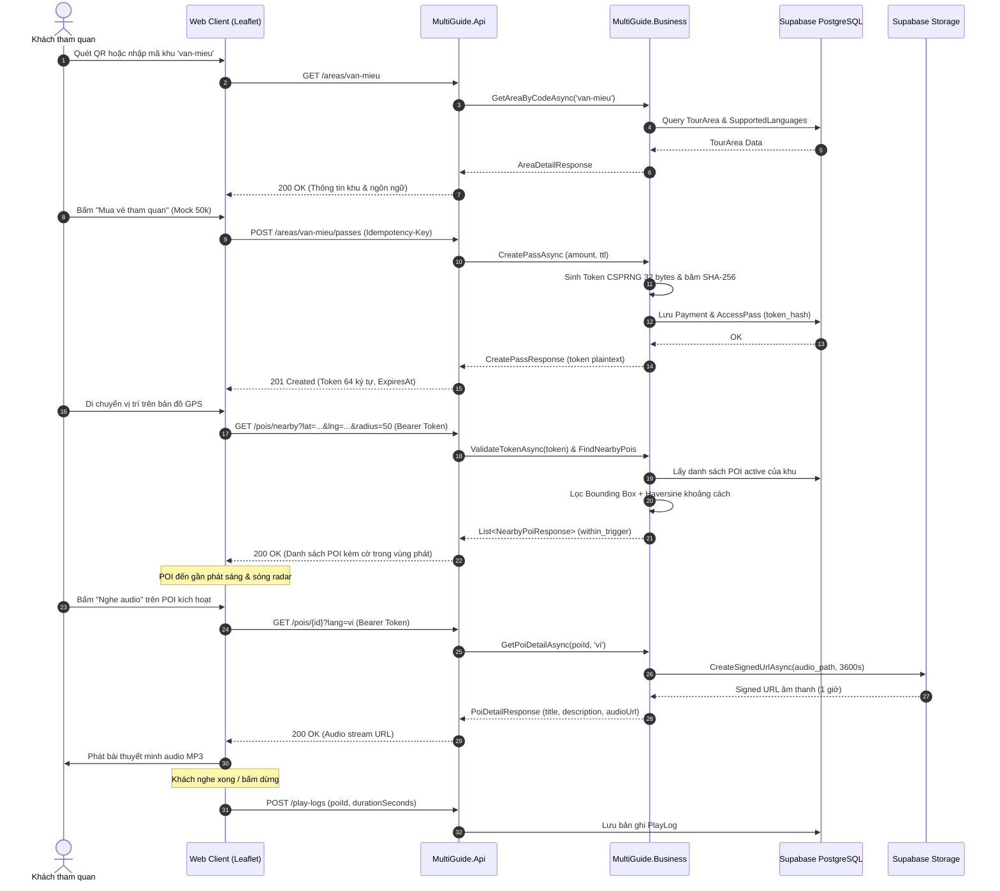
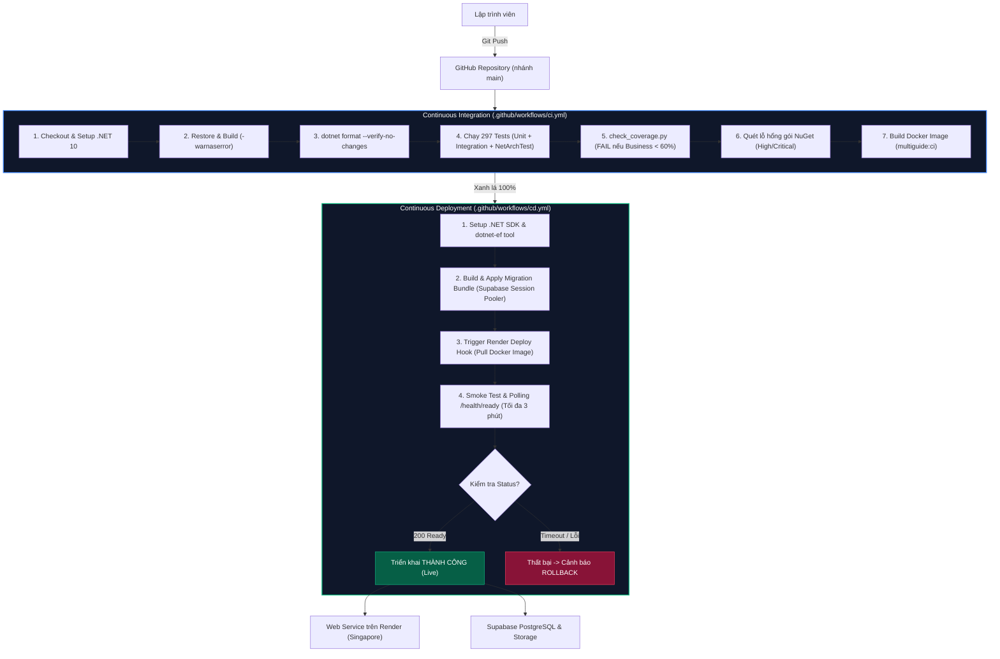

# SƠ ĐỒ BÁO CÁO DỰ ÁN MULTIGUIDE (Task T-4.10)

> Tài liệu tổng hợp các sơ đồ kỹ thuật (Component, Use Case, ERD, CI/CD Pipeline, Sequence) xuất trực tiếp phục vụ viết báo cáo và slide thuyết minh đồ án.

---

## 1. Sơ đồ Kiến trúc 3 lớp (Component Architecture Diagram)

Hệ thống được tổ chức theo mô hình Modular Monolith 3 lớp nghiêm ngặt, tuân thủ nguyên tắc Dependency Inversion:

---

## 2. Sơ đồ Use Case (Use Case Diagram)

Phân tách ranh giới rõ ràng giữa khách tham quan vãng lai, khách đã mua vé, và quản trị viên:

---

## 3. Sơ đồ Thực thể CSDL (Entity Relationship Diagram - ERD)

7 thực thể dữ liệu chuẩn hóa trên Supabase PostgreSQL, kích hoạt RLS (Row Level Security) không policy:

---

## 4. Sơ đồ Tuần Tự Luồng Khách Tham Quan (Sequence Diagram)

Mô tả luồng từ lúc quét mã QR ➔ mua vé ➔ giả lập GPS ➔ nghe audio thuyết minh:

---

## 5. Sơ đồ Pipeline CI/CD Tự Động Hóa (CI/CD Pipeline Diagram)

Quy trình phát triển và triển khai tự động hóa bảo đảm chất lượng phần mềm:

